<div align="center">

<a href="https://tjnorman.github.io/wi7-atlas/">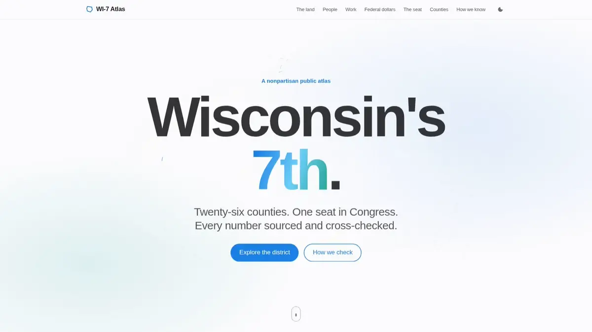</a>

<h1>WI-7 Atlas</h1>

<h3>Wisconsin's 7th Congressional District, counted.</h3>

<p>A public, nonpartisan atlas of Wisconsin's 7th Congressional District: who lives there, how they make a living,<br/>what federal money reaches it, and how the seat in Congress has been held and voted.<br/><b>Every number links to its primary source, and independent sources are checked against each other before anything ships.</b></p>

<p>
<a href="https://tjnorman.github.io/wi7-atlas/"><picture><source media="(prefers-color-scheme: dark)" srcset="docs/media/buttons/open-dark.svg" /></picture></a>
&nbsp;
<a href="#-how-every-number-is-checked"><picture><source media="(prefers-color-scheme: dark)" srcset="docs/media/buttons/checks-dark.svg" /></picture></a>
&nbsp;
<a href="data/wi-07/"><picture><source media="(prefers-color-scheme: dark)" srcset="docs/media/buttons/data-dark.svg" /></picture></a>
</p>

[](https://github.com/tjnorman/wi7-atlas/actions/workflows/tests.yml)
[](https://github.com/tjnorman/wi7-atlas/actions/workflows/data.yml)
[](https://github.com/tjnorman/wi7-atlas/actions/workflows/pages.yml)
[](#-how-every-number-is-checked)
[](#-sources)
[](data/wi-07/manifest.json)

[](LICENSE)

<table>
<tr>
<td align="center" width="25%"><h2>750,669</h2>People</td>
<td align="center" width="25%"><h2>23,111</h2>Square miles of land</td>
<td align="center" width="25%"><h2>26</h2>Counties</td>
<td align="center" width="25%"><h2>$76,055</h2>Median household income</td>
</tr>
<tr>
<td align="center" width="25%"><h2>46.3</h2>Median age</td>
<td align="center" width="25%"><h2>7.5%</h2>Adults who are veterans</td>
<td align="center" width="25%"><h2>90.3%</h2>Households with broadband</td>
<td align="center" width="25%"><h2>17.4%</h2>Homes held for seasonal use</td>
</tr>
</table>

<sub>People, income, age, and homes: American Community Survey 2025 1-year estimates. Land and counties: U.S. Census Bureau, 119th Congress boundaries. Federal awards: USAspending.gov.</sub>

[The district](#-the-district-in-one-picture) · [People](#-who-lives-here) · [Work](#-how-people-make-a-living) · [Federal dollars](#-federal-dollars) · [Representation](#-representation-and-elections) · [Counties](#-county-by-county) · [Checks](#-how-every-number-is-checked) · [Reuse it](#-reuse-it-for-another-district) · [Sources](#-sources)

</div>

---

## 🧭 What this is

<table>
<tr>
<td width="33%" valign="top">

### 📍 One district, in full
Twenty-six counties from Lake Superior to central Wisconsin, mapped to the boundaries the U.S. House uses today, with the five split counties drawn as they really are.

</td>
<td width="33%" valign="top">

### 🧾 Every number has a receipt
Each figure carries its publisher, the exact query, the data vintage, and the day it was retrieved. Sources are cited in APA style on the site and below.

</td>
<td width="33%" valign="top">

### 🔁 Refreshed and re-checked
A scheduled GitHub Action rebuilds the data each week, runs 28 cross-checks between independent sources, and redraws every chart in this README.

</td>
</tr>
</table>

<p align="center"><a href="https://tjnorman.github.io/wi7-atlas/media/tour.mp4"></a></p>
<p align="center"><sub>A 40-second tour of the website. Click for the full-quality video.</sub></p>

## 🖼 Gallery

<table>
<tr><td width="50%" valign="top"><picture><source media="(prefers-color-scheme: dark)" srcset="docs/media/screens/land-dark.png" /></picture><br/><sub>The scroll-driven map: each step recolors the counties</sub></td><td width="50%" valign="top"><picture><source media="(prefers-color-scheme: dark)" srcset="docs/media/screens/people-dark.png" />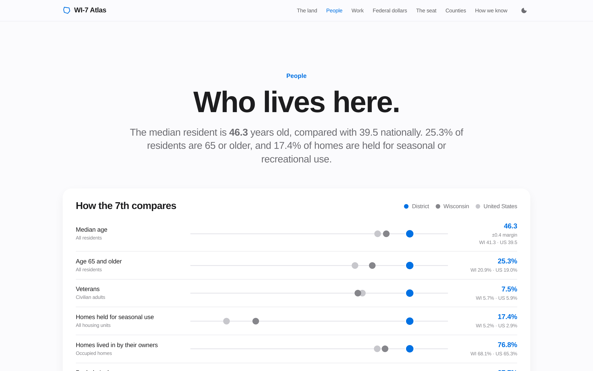</picture><br/><sub>How the district compares with Wisconsin and the nation</sub></td></tr>
<tr><td width="50%" valign="top"><picture><source media="(prefers-color-scheme: dark)" srcset="docs/media/screens/seat-dark.png" />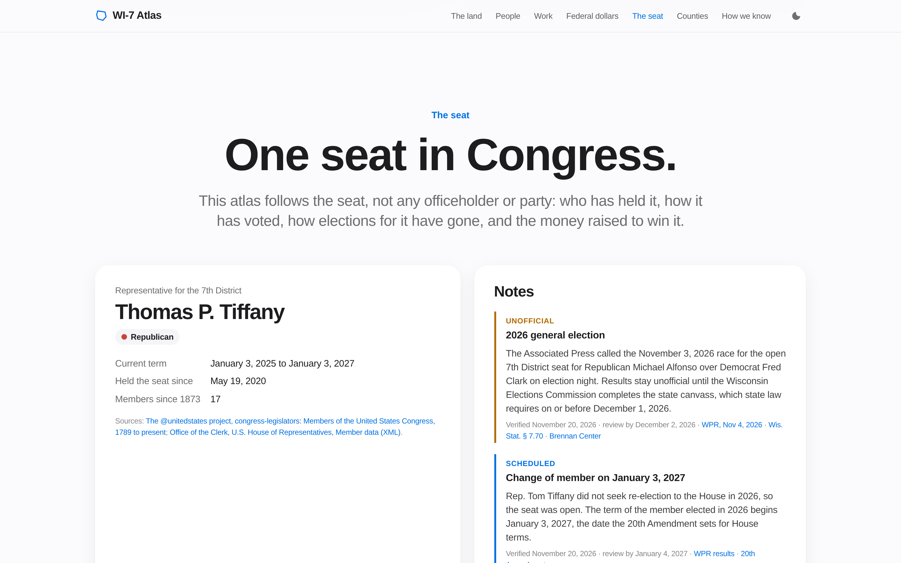</picture><br/><sub>The seat: members, notes, votes, and elections</sub></td><td width="50%" valign="top"><picture><source media="(prefers-color-scheme: dark)" srcset="docs/media/screens/trust-dark.png" /></picture><br/><sub>Every cross-check, in public</sub></td></tr>
</table>

## 🗺 The district in one picture

<p align="center"><picture><source media="(prefers-color-scheme: dark)" srcset="docs/media/charts/map-dark.svg" /></picture></p>

Since the 2020 Census, **17 of the district's 26 counties have gained people and 9 have lost people** (whole-county estimates to July 2025). The largest gain is in **St. Croix County (+5.1%)** and the largest decline in **Douglas County (-0.7%)**. In 22 counties deaths have outnumbered births since 2020, and 25 counties have gained people through migration. It is the largest of Wisconsin's 8 districts by land area, covering 43% of the state's land. The district had **736,715 residents in the 2020 Census** and an estimated **750,669 in 2025**.

<p align="center"><picture><source media="(prefers-color-scheme: dark)" srcset="docs/media/charts/population-dark.svg" /></picture></p>

## 👥 Who lives here

American Community Survey 2025 1-year estimates. Margins of error appear on the website. American Indian and Alaska Native residents make up 2.0% of the district (not Hispanic, one race alone), compared with 0.6% nationally.

| | District | Wisconsin | United States |
|---|---:|---:|---:|
| Median age | **46.3** (±0.4) | 41.3 | 39.5 |
| Age 65 and older | **25.3%** | 20.9% | 19.0% |
| Veterans (adults) | **7.5%** | 5.7% | 5.9% |
| Homes held for seasonal use | **17.4%** | 5.2% | 2.9% |
| Households with broadband | **90.3%** | 92.7% | 94.0% |

<p align="center"><picture><source media="(prefers-color-scheme: dark)" srcset="docs/media/charts/compare-dark.svg" /></picture></p>

<p align="center"><picture><source media="(prefers-color-scheme: dark)" srcset="docs/media/charts/age-dark.svg" /></picture></p>

## 💼 How people make a living

The most common line of work for district residents is **health care, social assistance, and education (22.4% of workers)**. Manufacturing employs **18.4%** of working residents, compared with 16.6% statewide. In September 2026, county unemployment rates ranged from **2.3% to 4.0%**, against 2.9% for Wisconsin and 4.0% nationally (not seasonally adjusted; the latest month is preliminary).

<p align="center"><picture><source media="(prefers-color-scheme: dark)" srcset="docs/media/charts/industry-dark.svg" /></picture></p>

<p align="center"><picture><source media="(prefers-color-scheme: dark)" srcset="docs/media/charts/unemployment-dark.svg" /></picture></p>

## 🏛 Federal dollars

In fiscal year 2026, federal agencies obligated **$5.74 billion** in contracts, grants, loans, and other awards for work performed in the district. The largest category was direct payments ($5.31 billion). Obligations are commitments to spend, and agencies revise them over time. Payments that agencies report only at the county or state level, such as many benefits paid to individuals, are not included.

<p align="center"><picture><source media="(prefers-color-scheme: dark)" srcset="docs/media/charts/federal-dark.svg" /></picture></p>

<details><summary><b>Top awarding agencies, FY2026</b></summary>

| Agency | Obligations |
|---|---:|
| Social Security Administration | $4.55 billion |
| Department of Veterans Affairs | $468.6 million |
| Department of Transportation | $175.4 million |
| Department of Health and Human Services | $122.4 million |
| Department of Agriculture | $115.2 million |
| Department of the Interior | $64.5 million |

</details>

### Social Security

In December 2025, **215,526** people in the district received Social Security, and the program paid them **$407.4 million** that month: 174,074 retired workers, 20,019 disabled workers, and their families and survivors. Another 10,406 people received Supplemental Security Income ($7.3 million that month).

<sub>Source: Social Security Administration, Congressional Statistics, December 2025. Counts are people receiving a benefit in December, and dollars are the total paid for that one month. The atlas does not multiply by twelve, because benefits change during the year. These payments go to people directly and are not part of the award totals above. Social Security payroll taxes paid are not published by congressional district.</sub>

### What residents pay in federal income tax

On 368,470 individual returns for tax year 2023, people living in the district reported a total federal tax liability of **$3.61 billion**, or 12.2% of their adjusted gross income.

| Per return, tax year 2023 | Adjusted gross income | Federal income tax | Tax as a share of income |
|---|---:|---:|---:|
| The district | $80,296 | $9,803 | 12.2% |
| Wisconsin | $86,605 | $11,238 | 13.0% |
| United States | $95,156 | $14,127 | 14.8% |

<sub>Source: IRS Statistics of Income, congressional district data. Individual income tax returns only. Employer payroll taxes, corporate income tax, excise taxes, and estate taxes are not published by congressional district, so this is not the district's total federal tax, and it is not a balance against the awards above.</sub>

## 🎓 Colleges and universities

6 colleges, universities, and career schools have their main address in the district.

| Institution | City | County | Control | Level |
|---|---|---|---|---|
| [Lac Courte Oreilles Ojibwe University](https://www.lco.edu/) | Hayward | Sawyer | Public | Four or more years |
| [Nicolet Area Technical College](https://www.nicoletcollege.edu/) | Rhinelander | Oneida | Public | At least 2 but less than 4 years |
| [Northcentral Technical College](https://www.ntc.edu/) | Wausau | Marathon | Public | At least 2 but less than 4 years |
| [Northwood Technical College](https://www.northwoodtech.edu/) | Rice Lake | Barron | Public | At least 2 but less than 4 years |
| [State College of Beauty Culture](https://www.statecollegeofbeauty.com/) | Wausau | Marathon | Private for-profit | Less than 2 years (below associate) |
| [University of Wisconsin-Superior](https://www.uwsuper.edu/) | Superior | Douglas | Public | Four or more years |

<sub>Source: National Center for Education Statistics, IPEDS directory file HD2024. IPEDS lists each institution once, at its main address. Branch campuses and outreach centers inside the district that report under a parent institution are not listed. Northland College (Ashland) is in the directory but is not counted: Closed at the end of the 2024-25 academic year. The Board of Trustees voted to close the college on February 19, 2025.</sub>

## 📻 Radio and television

117 licensed stations transmit from inside the district: 77 FM, 27 AM, and 13 television.

<details><summary><b>Every station</b></summary>

| Call sign | Frequency | Type | Licensed to | Licensee | Listen online |
|---|---|---|---|---|---|
| WLAK | 1260 kHz | AM radio | Amery | Civic Media, Inc. |  |
| WATK | 900 kHz | AM radio | Antigo | Results Broadcasting Inc. |  |
| WATW | 1400 kHz | AM radio | Ashland | Heartland Comm. License, Llc |  |
| WLBL | 930 kHz | AM radio | Auburndale | State Of Wisconsin - Educational Communications Board |  |
| WERL | 950 kHz | AM radio | Eagle River | Heartland Comm. License, Llc |  |
| WBZH | 910 kHz | AM radio | Hayward | Civic Media, Inc. |  |
| WDGY | 740 kHz | AM radio | Hudson | Wrpx, Inc. |  |
| WHRY | 1450 kHz | AM radio | Hurley | Baroka Broadcasting, Inc. |  |
| WLDY | 1340 kHz | AM radio | Ladysmith | Zoe Communications Inc |  |
| WDLB | 1450 kHz | AM radio | Marshfield | Central Wisconsin Broadcasting, Inc. |  |
| WIGM | 1490 kHz | AM radio | Medford | Wigm, Inc. |  |
| WJMT | 730 kHz | AM radio | Merrill | Sunrise Broadcasting Llc. |  |
| WLKD | 1570 kHz | AM radio | Minocqua | Raven License Sub, Llc |  |
| WCCN | 1370 kHz | AM radio | Neillsville | Central Wisconsin Broadcasting, Inc. |  |
| WIXK | 1590 kHz | AM radio | New Richmond | Hmong Radio Broadcast, Llc |  |
| WPFP | 980 kHz | AM radio | Park Falls | Civic Media, Inc. |  |
| WOBT | 1240 kHz | AM radio | Rhinelander | Nrg License Sub, Llc |  |
| WAQE | 1090 kHz | AM radio | Rice Lake | Amc Partners Rice Lake, Llc |  |
| WJMC | 1240 kHz | AM radio | Rice Lake | Amc Partners Rice Lake, Llc |  |
| WEVR | 1550 kHz | AM radio | River Falls | Hanten Broadcasting Co. Inc. |  |
| WRIG | 1390 kHz | AM radio | Schofield | Wrig, Inc. |  |
| WXNK | 940 kHz | AM radio | Shell Lake | Zoe Communications, Inc. |  |
| WDSM | 710 kHz | AM radio | Superior | Midwest Communications, Inc. |  |
| WDUL | 970 kHz | AM radio | Superior | Midwest Communications, Inc. |  |
| WJJQ | 810 kHz | AM radio | Tomahawk | Albert Broadcasting Ii Llc |  |
| WSAU | 550 kHz | AM radio | Wausau | Wrig, Inc. |  |
| WXCO | 1230 kHz | AM radio | Wausau | Civic Media, Inc. |  |
| WPCA-LP | 93.1 MHz | Low-power FM radio | Amery | Dream Center, Inc. |  |
| WACD | 106.1 MHz | FM radio | Antigo | Results Broadcasting Inc. |  |
| WRLO-FM | 105.3 MHz | FM radio | Antigo | Nrg License Sub, Llc |  |
| WBSZ | 93.3 MHz | FM radio | Ashland | Heartland Comm. License, Llc |  |
| WDNW | 91.9 MHz | FM radio | Ashland | University Of Northwestern - St. Paul |  |
| WJJH | 96.7 MHz | FM radio | Ashland | Heartland Comm. License, Llc |  |
| WUWS | 90.9 MHz | FM radio | Ashland | Board Of Regents Of The University Of Wisconsin System |  |
| WWMD-LP | 94.3 MHz | Low-power FM radio | Ashland | Holy Family Radio Association |  |
| WSCM | 95.7 MHz | FM radio | Baldwin | Civic Media, Inc. |  |
| WZEZ | 104.9 MHz | FM radio | Balsam Lake | Zoe Communications, Inc. |  |
| WAQE-FM | 97.7 MHz | FM radio | Barron | Amc Partners Rice Lake, Llc |  |
| WYNW | 92.9 MHz | FM radio | Birnamwood | Relevant Radio, Inc. |  |
| WHSA | 89.9 MHz | FM radio | Brule | State Of Wisconsin - Educational Communications Board |  |
| WPGR-LP | 105.7 MHz | Low-power FM radio | Clear Lake | Clear Lake Christian Radio, Inc. |  |
| WCWL-LP | 103.5 MHz | Low-power FM radio | Clearwater Lake | Northern Lakes Radio, Inc. |  |
| WGNW | 99.9 MHz | FM radio | Cornell | The Family Radio Network, Inc. |  |
| WEQC | 103.9 MHz | FM radio | Crandon | The Salvation Poem Foundation, Inc. |  |
| WRJO | 94.5 MHz | FM radio | Eagle River | Heartland Comm. License, Llc |  |
| WVCF | 90.5 MHz | FM radio | Eau Claire | Vcy America, Inc. |  |
| WMVM | 90.7 MHz | FM radio | Goodman | Wrvm, Inc. |  |
| WWIB | 103.7 MHz | FM radio | Hallie | Stewards Of Sound, Inc. |  |
| WHSM-FM | 101.1 MHz | FM radio | Hayward | Civic Media, Inc. |  |
| WRLS-FM | 92.3 MHz | FM radio | Hayward | Vacationland Broadcasting, Inc. |  |
| WNXR | 107.3 MHz | FM radio | Iron River | Heartland Comm. License, Llc |  |
| WLDF | 92.9 MHz | FM radio | Lac Du Flambeau | L.D.F. Business Development Corp. |  |
| WJBL | 93.1 MHz | FM radio | Ladysmith | Zoe Communications Inc |  |
| WCWB | 104.9 MHz | FM radio | Marathon | Muzzy Broadcast Group, Llc |  |
| WKEB | 99.3 MHz | FM radio | Medford | Wigm, Incorporated |  |
| WDYD-LP | 102.5 MHz | Low-power FM radio | Merrill | The New Testament Church, Inc. |  |
| WHJL | 88.1 MHz | FM radio | Merrill | Wrvm, Inc. |  |
| WXVM | 104.1 MHz | FM radio | Merrill | Wrvm, Inc. |  |
| WMQA-FM | 95.9 MHz | FM radio | Minocqua | Raven License Sub, Llc |  |
| WQMN | 88.7 MHz | FM radio | Minocqua | Radio 74 Internationale |  |
| WOZZ | 94.7 MHz | FM radio | Mosinee | Wrig, Inc. |  |
| WCCN-FM | 107.5 MHz | FM radio | Neillsville | Central Wisconsin Broadcasting, Inc. |  |
| WPKG | 92.7 MHz | FM radio | Neillsville | Central Wisconsin Broadcasting, Inc. |  |
| WVCS | 90.1 MHz | FM radio | Owen | Vcy America, Inc. |  |
| WCQM | 98.3 MHz | FM radio | Park Falls | Civic Media, Inc. |  |
| WHBM | 90.3 MHz | FM radio | Park Falls | State Of Wisconsin - Educational Communications Board |  |
| WOJB | 88.9 MHz | FM radio | Reserve | Lac Courte Oreilles Ojibwa Public |  |
| KSPP | 89.1 MHz | FM radio | Rhinelander | Northwoods Catholic Radio |  |
| WHDG | 97.3 MHz | FM radio | Rhinelander | Raven License Sub, Llc |  |
| WHSF | 89.9 MHz | FM radio | Rhinelander | State Of Wisconsin - Educational Communications Board |  |
| WNWX | 96.5 MHz | FM radio | Rhinelander | Heartland Comm. License, Llc |  |
| WRHN | 100.1 MHz | FM radio | Rhinelander | Nrg License Sub, Llc |  |
| WXPR | 91.7 MHz | FM radio | Rhinelander | White Pine Community Broadcasting, Inc. |  |
| WEPP-FM | 90.7 MHz | FM radio | Rice Lake | State Of Wisconsin Educational Communications Board |  |
| WGIF | 90.1 MHz | FM radio | Rice Lake | Barron Calvary Baptist Church, Inc |  |
| WJMC-FM | 96.1 MHz | FM radio | Rice Lake | Amc Partners Rice Lake, Llc |  |
| WKFX | 99.1 MHz | FM radio | Rice Lake | Amc Partners Rice Lake, Llc |  |
| WWJP-LP | 101.7 MHz | Low-power FM radio | Rice Lake | Meadow Creek Christian Radio Corporation |  |
| WYRL-LP | 105.5 MHz | Low-power FM radio | Rice Lake | Law Enforcement Foundation Of Barron County |  |
| WEVR-FM | 106.3 MHz | FM radio | River Falls | Hanten Broadcasting Company, Inc. |  |
| WRFW | 88.7 MHz | FM radio | River Falls | Board Of Regents Of The University Of Wisconsin System |  |
| WAVL | 100.5 MHz | FM radio | Rothschild | Sunrise Broadcasting Llc. |  |
| WPLT | 106.3 MHz | FM radio | Sarona | Zoe Communications, Inc. |  |
| WXCX | 105.7 MHz | FM radio | Siren | Zoe Communications, Inc. |  |
| WOSQ | 92.3 MHz | FM radio | Spencer | Central Wisconsin Broadcasting, Inc. |  |
| WGMO | 95.3 MHz | FM radio | Spooner | Zoe Communications, Inc. |  |
| WASB-LP | 96.5 MHz | Low-power FM radio | Stanley-Boyd-Cadott | All Saints Catholic Parish |  |
| WGHF-LP | 93.7 MHz | Low-power FM radio | Superior | Superior Seventh-Day Adventist Church |  |
| WCYE | 93.7 MHz | FM radio | Three Lakes | Heartland Comm. License, Llc |  |
| WEQR | 100.9 MHz | FM radio | Tomahawk | The Salvation Poem Foundation, Inc. |  |
| WGBT | 91.3 MHz | FM radio | Tomahawk | Radio 74 Internationale |  |
| WJJQ-FM | 92.5 MHz | FM radio | Tomahawk | Albert Broadcasting Ii Llc |  |
| WLBI-LP | 107.1 MHz | Low-power FM radio | Tomahawk | Above And Beyond Broadcasting, Inc. |  |
| WEGZ | 105.9 MHz | FM radio | Washburn | Keweenaw Bay Broadcasting, Inc. |  |
| WHWA | 104.7 MHz | FM radio | Washburn | State Of Wisconsin - Educational Communications Board |  |
| WBCV | 107.9 MHz | FM radio | Wausau | Nrg License Sub, Llc |  |
| WCLQ | 89.5 MHz | FM radio | Wausau | Christian Life Communications, Inc. |  |
| WDEZ | 101.9 MHz | FM radio | Wausau | Wrig, Inc. |  |
| WHRM | 90.9 MHz | FM radio | Wausau | State Of Wisconsin - Educational Communications Board |  |
| WIFC | 95.5 MHz | FM radio | Wausau | Wrig, Inc. |  |
| WLBL-FM | 91.9 MHz | FM radio | Wausau | State Of Wisconsin - Educational Communications Board |  |
| WNRB-LP | 93.3 MHz | Low-power FM radio | Wausau | Wausau Area Hmong Mutual Association |  |
| WXPW | 91.9 MHz | FM radio | Wausau | White Pine Community Broadcasting, Inc. |  |
| WWEN | 88.1 MHz | FM radio | Wentworth | Real Presence Radio |  |
| WTPX-TV | Channel 19 | Full-power television | Antigo | Ion Television License, Llc |  |
| WMOW | Channel 13 | Full-power television | Crandon | Wausau Tv License Company, Llc |  |
| WNWE | Channel 26 | Full-power television | Eagle River | Gray Television Licensee, Llc |  |
| WYOW | Channel 28 | Full-power television | Eagle River | Gray Television Licensee, Llc |  |
| WLEF-TV | Channel 36 | Full-power television | Park Falls | State Of Wisconsin - Educational Communications Board |  |
| WJFW-TV | Channel 16 | Full-power television | Rhinelander | Northland Television, Llc |  |
| W21EW-D | Channel 21 | Low-power television or translator | Wausau | Hc2 Station Group, Inc. |  |
| W27AU-D | Channel 27 | Low-power television or translator | Wausau | Northland Television, Llc |  |
| W36EI-D | Channel 36 | Low-power television or translator | Wausau | Edge Spectrum, Inc. |  |
| WAOW | Channel 9 | Full-power television | Wausau | Wausau Tv License Company, Llc |  |
| WHRM-TV | Channel 24 | Full-power television | Wausau | State Of Wisconsin - Educational Communications Board |  |
| WSAW-TV | Channel 7 | Full-power television | Wausau | Gray Television Licensee, Llc |  |
| WZAW-LD | Channel 33 | Low-power television or translator | Wausau | Gray Television Licensee, Llc |  |

</details>

<sub>Source: Federal Communications Commission AM, FM, and TV queries, as of 2026-11-24. Listed: licensed stations whose transmitter stands inside the district outline. Translators and boosters are left out. Stations that are received in the district from transmitters outside it are not listed.</sub>

## 🏘 Cities, villages, and towns

The district takes in all or part of **607 municipalities**: 51 cities, 90 villages, and 466 towns. 8 of them are themselves divided by the district line. The full list, with each one's status, is in [`data/wi-07/municipalities.json`](data/wi-07/municipalities.json).

<sub>Source: U.S. Census Bureau, congressional district to county subdivision relationship file. A municipality that crosses a county line is listed once in each county. Status is by share of land area as of the 2020 Census; the file has no population by part.</sub>

## 🌉 Bridge update: Blatnik Bridge replacement

The John A. Blatnik Bridge carries Interstate 535 over St. Louis Bay between Superior and Duluth. The Minnesota and Wisconsin transportation departments own it jointly and are replacing it on the same alignment. Minnesota leads the project.

| | | |
|---|---|---|
| Estimated cost | **$1.8 billion** | Including inflation; estimate published in 2024. |
| Federal grant | **$1.058 billion** | Awarded in early 2024 under the federal infrastructure law. |
| Each state's share | **Up to $400 million** | Minnesota and Wisconsin split the rest equally. |
| Vehicles a day | **About 33,000** |  |
| Full closure | **No earlier than March 1, 2027** |  |
| Length of closure | **Four to five years** |  |
| New bridge opens | **By October 31, 2031** | Overall completion in 2032. |

| When | What |
|---|---|
| December 1961 | The bridge opened to traffic. |
| Early 2024 | The two states received the federal grant. |
| Fall 2026 | Lane changes, traffic signal work, and new pavement markings are planned on Belknap Street (U.S. 2) in Superior ahead of the closure. The contractor is Ames-Kraemer Joint Venture II. |
| Before the closure | Wisconsin is improving Winter Street and Susquehanna Avenue in Superior as alternate routes. Its part of the project also replaces the I-535 and Highway 35 interchange and rebuilds a segment of U.S. 53. |
| March 1, 2027, at the earliest | Full closure, so crews can remove the existing bridge. |
| October 31, 2031 | Date by which the new bridge is scheduled to open. |

<sub>Source: the Minnesota and Wisconsin transportation departments' own project pages and releases, read 2026-11-24; listed under Sources. Dates and costs are the agencies' published plans as of the date read, and can change.</sub>

## 🗳 Representation and elections

The seat is held by **Thomas P. Tiffany (Republican)**, whose current term runs from January 3, 2025 to January 3, 2027. 17 people have represented the 7th District since 1873, under boundaries redrawn after each census.

<p align="center"><picture><source media="(prefers-color-scheme: dark)" srcset="docs/media/charts/seat-dark.svg" /></picture></p>

> **2026 general election** — 🟡 Unofficial, verified November 20, 2026
>
> The Associated Press called the November 3, 2026 race for the open 7th District seat for Republican Michael Alfonso over Democrat Fred Clark on election night. Results stay unofficial until the Wisconsin Elections Commission completes the state canvass, which state law requires on or before December 1, 2026.
>
> <sub>Sources: [WPR, Nov 4, 2026](https://www.wpr.org/news/republican-michael-alfonso-wins-northern-wisconsin-district) · [Wis. Stat. § 7.70](https://docs.legis.wisconsin.gov/statutes/statutes/7/70) · [Brennan Center](https://www.brennancenter.org/our-work/research-reports/wisconsin-election-certification-processes-and-guardrails)</sub>

> **Change of member on January 3, 2027** — 🗓 Scheduled, verified November 20, 2026
>
> Rep. Tom Tiffany did not seek re-election to the House in 2026, so the seat was open. The term of the member elected in 2026 begins January 3, 2027, the date the 20th Amendment sets for House terms.
>
> <sub>Sources: [WPR results](https://www.wpr.org/news/wisconsin-congressional-election-results-november-2026) · [20th Amendment](https://constitution.congress.gov/constitution/amendment-20/)</sub>

<p align="center"><picture><source media="(prefers-color-scheme: dark)" srcset="docs/media/charts/elections-dark.svg" /></picture></p>

<details open><summary><b>How the seat voted in the 119th Congress</b> (686 yes-or-no roll calls)</summary>

| Measure | The seat | Plain definition |
|---|---:|---|
| Votes missed | **11.2%** | Share of yes-or-no roll calls, while the member held the seat, recorded as Not Voting. House-wide: 3.2%. |
| Voted with own party's majority | **93.6%** | Share of the member's yes-or-no votes that matched the position taken by most members of the member's own party. Ties are left out. |
| Voted on the winning side | **83.6%** | Share of the member's yes-or-no votes that matched the outcome. |

Source: Office of the Clerk, U.S. House of Representatives, roll call votes. The website lists the 25 most recent votes with links.

</details>

<details open><summary><b>Attendance, 2017 to 2026</b> (239 missed of 4,785 roll calls, 5.0%)</summary>

| Year | Held by | Roll calls while held | Missed | Missed | Whole House | While vacant |
|---|---|---:|---:|---:|---:|---:|
| 2017 | Sean P. Duffy | 708 | 28 | 4.0% | 3.3% | — |
| 2018 | Sean P. Duffy | 498 | 16 | 3.2% | 5.7% | — |
| 2019 | Sean P. Duffy | 538 | 37 | 6.9% | 3.1% | 161 |
| 2020 | Thomas P. Tiffany | 144 | 10 | 6.9% | 5.6% | 108 |
| 2021 | Thomas P. Tiffany | 447 | 35 | 7.8% | 1.9% | — |
| 2022 | Thomas P. Tiffany | 548 | 8 | 1.5% | 2.0% | — |
| 2023 | Thomas P. Tiffany | 700 | 10 | 1.4% | 2.9% | — |
| 2024 | Thomas P. Tiffany | 516 | 18 | 3.5% | 5.1% | — |
| 2025 | Thomas P. Tiffany | 360 | 18 | 5.0% | 3.3% | — |
| 2026 | Thomas P. Tiffany | 326 | 59 | 18.1% | 3.2% | — |

The Clerk records Not Voting for any absence, whatever the reason. The record does not say why a vote was missed, and it does not show votes later explained in the Congressional Record. 269 roll calls were taken while the seat was vacant and are not counted as missed. The website lists every missed vote with a link to the official record.

</details>

<details><summary><b>Campaign money, 2026 cycle</b> (Federal Election Commission)</summary>

| Candidate | Party | Raised | Spent | Cash on hand | Through |
|---|---|---:|---:|---:|---|
| [Wassgren, Paul](https://www.fec.gov/data/candidate/H6WI07215/?cycle=2026) | REPUBLICAN PARTY | $3.4 million | $3.4 million | $0 | 2026-06-30 |
| [Alfonso, Michael](https://www.fec.gov/data/candidate/H6WI07223/?cycle=2026) | REPUBLICAN PARTY | $1.8 million | $1.3 million | $426,939 | 2026-10-14 |
| [Hermening, Kevin](https://www.fec.gov/data/candidate/H6WI07249/?cycle=2026) | REPUBLICAN PARTY | $1.6 million | $1.5 million | $51,049 | 2026-09-30 |
| [Clark, Frederic](https://www.fec.gov/data/candidate/H6WI07207/?cycle=2026) | DEMOCRATIC PARTY | $863,780 | $602,936 | $260,844 | 2026-10-14 |
| [Ebben, Jessi](https://www.fec.gov/data/candidate/H0WI03159/?cycle=2026) | REPUBLICAN PARTY | $555,645 | $496,402 | $60,845 | 2026-09-30 |
| [Tiffany, Tom](https://www.fec.gov/data/candidate/H0WI07101/?cycle=2026) | REPUBLICAN PARTY | $170,882 | $326,460 | $20,363 | 2026-10-14 |
| [Murray, Ginger L](https://www.fec.gov/data/candidate/H6WI07231/?cycle=2026) | DEMOCRATIC PARTY | $159,921 | $138,920 | $21,000 | 2026-07-22 |
| [Armstrong, Christopher Campbell](https://www.fec.gov/data/candidate/H6WI07199/?cycle=2026) | DEMOCRATIC PARTY | $38,552 | $38,875 | $-323 | 2026-09-30 |
| [Threlfall-Baum, Niina](https://www.fec.gov/data/candidate/H6WI07256/?cycle=2026) | REPUBLICAN PARTY | $25,274 | $21,024 | $4,249 | 2026-07-22 |

Totals for each candidate's principal campaign committee over the two-year cycle, through its latest report. Sorted by amount raised.

</details>

## 🏘 County by county

<details open><summary><b>All 26 counties</b></summary>

| County | In district | Population 2025 | Since 2020 | Median household income | Median age | Unemployment | Jobs (QCEW) |
|---|---|---:|---:|---:|---:|---:|---:|
| Ashland | Whole | 16,203 | +1.1% | $62,462 | 43.1 | 2.9% | 7,864 |
| Barron | Whole | 46,484 | -0.5% | $65,933 | 44.9 | 2.8% | 21,222 |
| Bayfield | Whole | 16,787 | +3.5% | $71,151 | 54.6 | 3.0% | 4,295 |
| Burnett | Whole | 17,223 | +4.2% | $62,819 | 56.0 | 3.3% | 5,212 |
| Chippewa | Part (47% of people) | 67,614 | +2.0% | $74,680 | 42.2 | 2.7% | 27,224 |
| Clark | Whole | 35,052 | +1.2% | $67,400 | 36.7 | 2.3% | 11,428 |
| Douglas | Whole | 43,990 | -0.7% | $75,099 | 42.7 | 3.5% | 15,643 |
| Florence | Whole | 4,748 | +4.1% | $61,086 | 55.3 | 3.4% | 954 |
| Forest | Whole | 9,574 | +4.2% | $61,071 | 49.3 | 2.9% | 3,222 |
| Iron | Whole | 6,127 | -0.2% | $60,625 | 56.1 | 4.0% | 1,615 |
| Jackson | Part (10% of people) | 20,999 | -0.7% | $68,110 | 43.4 | 3.1% | 7,570 |
| Juneau | Part (22% of people) | 26,649 | -0.3% | $67,270 | 45.8 | 3.0% | 9,194 |
| Langlade | Whole | 19,534 | +0.2% | $55,878 | 48.7 | 3.0% | 7,152 |
| Lincoln | Whole | 28,403 | -0.0% | $68,164 | 49.3 | 2.9% | 9,938 |
| Marathon | Whole | 139,432 | +1.0% | $77,884 | 41.3 | 2.5% | 69,778 |
| Monroe | Part (10% of people) | 46,572 | +0.6% | $69,467 | 39.7 | 2.6% | 21,034 |
| Oneida | Whole | 38,131 | +0.8% | $69,371 | 52.7 | 2.6% | 17,262 |
| Polk | Whole | 45,803 | +1.8% | $77,219 | 46.7 | 3.0% | 15,663 |
| Price | Whole | 13,988 | -0.5% | $60,546 | 52.6 | 3.3% | 4,702 |
| Rusk | Whole | 14,146 | -0.2% | $59,944 | 49.2 | 3.5% | 4,396 |
| Sawyer | Whole | 18,846 | +4.2% | $60,801 | 52.8 | 3.2% | 7,329 |
| St. Croix | Whole | 98,276 | +5.1% | $103,046 | 40.4 | 2.8% | 37,379 |
| Taylor | Whole | 20,118 | +1.0% | $69,350 | 44.2 | 2.5% | 7,776 |
| Vilas | Whole | 23,761 | +3.1% | $68,431 | 55.7 | 3.0% | 8,411 |
| Washburn | Whole | 17,087 | +2.8% | $63,441 | 52.7 | 3.2% | 5,459 |
| Wood | Part (41% of people) | 74,060 | -0.2% | $67,989 | 43.8 | 2.9% | 35,407 |

Whole-county figures. Population: Census Bureau estimates. Income and age: American Community Survey 5-year estimates. Unemployment: BLS, latest month, not seasonally adjusted. Jobs: BLS QCEW annual average, counted where people work.

</details>

## ✅ How every number is checked

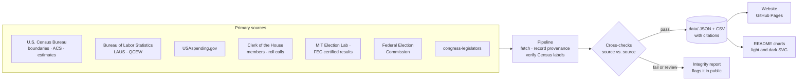

Three rules keep the atlas honest:

1. **Two sources or a recorded fact, every time it matters.** The county list is checked against the recorded 26 counties; the 2020 population must agree three ways; the sitting member must be the same in the volunteer-maintained record and in the Clerk's; the most recent election winner must be the member who took office after it.
2. **A label check before any Census number is used.** Every Census variable's official label is compared with what the atlas says it means. If a table is renumbered, that measure is dropped and the check fails in public.
3. **Nothing unofficial without a label and a review date.** Hand-written notes (like a race called by news organizations before certification) carry sources, a verification date, and a review-by date; an overdue note turns the check yellow.

**Latest build: 28 of 28 checks passing**.

| | Check | What was compared |
|---|---|---|
| ✅ Pass | FCC station records have the expected layout | 720 of 720 rows had hemisphere letters and plausible coordinates in the expected positions. |
| ✅ Pass | Every county in the district has municipalities in the district | 607 municipalities are in the district or split by its line (51 cities, 90 villages, 466 towns), across 26 of 26 counties. |
| ✅ Pass | IPEDS district codes agree with the district outline | All 7 institutions inside the outline carry this district's code in IPEDS, and no other Wisconsin institution does. |
| ✅ Pass | College directory variables match the IPEDS dictionary | 13 of 13 variables confirmed against the 2024 dictionary. |
| ✅ Pass | SSA tables use the current district lines | SSA states that its 2025 tables use district definitions for the 119th Congress; this atlas uses the 119th. |
| ✅ Pass | Wisconsin's districts add up to the state total for SSI | SSI recipients: districts sum to 107,505; state row 107,505. |
| ✅ Pass | Wisconsin's districts add up to the state total in the SSA tables | Beneficiaries: 8 districts sum to 1,398,745; state row 1,398,745. Monthly benefits: $2,776,804,000 against $2,776,804,000 (tolerance 1%). |
| ✅ Pass | IRS file uses the current district lines | The tax year 2023 documentation names the 118th Congress; this atlas uses the 119th. Wisconsin's lines have not changed since the 118th Congress. |
| ✅ Pass | Wisconsin's districts add up to the state total in the IRS file | Returns: state row 2,944,320; sum of 8 districts 2,944,320 (tolerance 2%; returns the IRS could not place in a district are counted only in the state row). |
| ✅ Pass | IRS income classes add up to the district total | Total tax liability: published total $3,612,071,000; sum of income classes $3,612,071,000 (tolerance 1%; the IRS rounds and suppresses small cells). |
| ✅ Pass | IRS variables match their published descriptions | 6 of 6 variables confirmed against the tax year 2023 documentation guide and within plausible range. |
| ✅ Pass | Every Census variable means what the atlas says it means | 210 of 210 variable labels matched the Census Bureau's official definitions for ACS 2025 1-year and ACS 2024 5-year. Education rows were chosen by label (found). |
| ✅ Pass | Every project fact names an official source | 13 facts across 1 project(s), each tied to a listed page. Read on 2026-11-24; due for re-reading by 2027-03-15. |
| ✅ Pass | The district's counties match the recorded list (26 counties: 21 whole, 5 split) | Census relationship file: 26 counties with land in the district, 21 whole; split: Chippewa, Jackson, Juneau, Monroe, Wood. Recorded: 26 counties, 21 whole; split: Chippewa, Jackson, Juneau, Monroe, Wood. |
| ✅ Pass | 2020 Census population agrees three ways (district total, sum of county parts, recorded figure) | District total 736,715; sum of county parts 736,715; recorded 736,715. |
| ✅ Pass | For whole counties, two Census files report the same 2020 population | 21 of 21 whole counties match between the 119th District Summary File and the 2020 redistricting file. |
| ✅ Pass | Land area agrees between the boundary file, the relationship file, and the recorded figure | Boundary file 23,111 sq mi; relationship file 23,111 sq mi; Gazetteer 23,111 sq mi; recorded 23,111 sq mi (tolerance 0.5% between Census files, 1% against the recorded figure). |
| ✅ Pass | The district holds about one-eighth of Wisconsin's people, as its eight equal districts should | ACS 2025 1-year: district 12.6% of the state (expected 11.5% to 13.5%). |
| ✅ Pass | County population estimates start from the 2020 Census counts | 26 counties compared; largest gap between the estimates base and the census count is 0.08% (Clark). Tolerance 1%. |
| ✅ Pass | Two independent records name the same sitting member | congress-legislators: Thomas P. Tiffany (T000165); Clerk of the House: Thomas P. Tiffany (T000165). |
| ✅ Pass | The most recent election winner in the results file is the member who took office after it | FEC certified results: Tom Tiffany won in 2022. congress-legislators: term starting 2023-01-03 held by Thomas P. Tiffany. |
| ✅ Pass | Two USAspending endpoints report the same district total for the last full fiscal year | FY2026: spending over time $5,736,701,212; spending by geography $5,736,701,212 (tolerance 1%). |
| ✅ Pass | No House roll call is missing from the vote record | 5,092 roll calls read, 2017 to 2026; none missing. |
| ✅ Pass | Every county has unemployment data through the same latest month | County data through 2026-09. All counties current. National data run through 2026-10; the atlas compares counties, Wisconsin, and the nation in the same month. |
| ✅ Pass | The sitting member's campaign appears in FEC records for the election they won | 3 candidates with financial activity in the 2022 cycle; found Tiffany. |
| ✅ Pass | Curated note reviewed on schedule: 2026 general election | Status unofficial; verified 2026-11-20; review by 2026-12-02. |
| ✅ Pass | Curated note reviewed on schedule: Change of member on January 3, 2027 | Status scheduled; verified 2026-11-20; review by 2027-01-04. |
| ✅ Pass | Curated note reviewed on schedule: Same lines for the 118th and 119th Congresses | Status verified; verified 2026-11-20; review by 2027-06-30. |

<details>
<summary><b>What a receipt looks like</b></summary>

Every data file wraps its numbers with the sources used to make them:

```json
{
  "generated_at": "2026-11-24T07:45:49+00:00",
  "sources": [
    {
      "id": "acs1",
      "publisher": "U.S. Census Bureau",
      "title": "American Community Survey 1-year estimates, 2025: Detailed tables",
      "url": "https://api.census.gov/data/2025/acs/acs1",
      "year": "2026",
      "kind": "Data set",
      "query": "https://api.census.gov/data/2025/acs/acs1?get=...&for=congressional district:07&in=state:55",
      "vintage": "ACS 2025 1-year",
      "accessed": "2026-11-24",
      "apa": "U.S. Census Bureau. (2026). American Community Survey 1-year estimates, 2025: Detailed tables [Data set]. Retrieved November 24, 2026, from https://api.census.gov/data/2025/acs/acs1"
    }
  ],
  "data": {
    "...": "numbers"
  }
}
```

</details>

## ♻️ Reuse it for another district

The whole atlas is driven by one small file. Copy [`config/districts/wi-07.yaml`](config/districts/wi-07.yaml), change the identifiers, and build:

```yaml
id: mn-08
name: Minnesota's 8th Congressional District
short_name: MN-8
state: { name: Minnesota, abbr: MN, fips: "27" }
district: "08"
district_number: 8
congress: 119
```

```bash
python -m pipeline all --district mn-08
```

The pipeline, the checks, the charts, and the website read everything district-specific from that file.

## 🛠 Run it yourself

```bash
git clone https://github.com/tjnorman/wi7-atlas.git && cd wi7-atlas
pip install -r requirements.txt && npm install  # Python pipeline, mapshaper for the map
python -m pipeline all                           # fetch, check, chart, and write README.md
python -m http.server -d site 8000               # then open http://localhost:8000
python -m pytest                                 # unit tests and site checks
```

Optional free API keys raise rate limits: `CENSUS_API_KEY`, `BLS_API_KEY`, `FEC_API_KEY` (from api.data.gov). Without them the pipeline uses the public limits.

<details>
<summary><b>Repository layout</b></summary>

```
config/districts/      one YAML file per district
pipeline/              Python: sources/, checks.py, charts.py, readme.py
data/<district>/       JSON outputs with citations, plus geo/ TopoJSON
data/curated/          hand-written notes, each with sources and a review date
site/                  the website (plain HTML, CSS, and ES modules; no build step)
tools/                 screenshots, video, and GIF rendering
tests/                 pytest unit tests and Playwright site checks
.github/workflows/     tests, weekly data refresh, Pages deploy, media
```

</details>

## 🤝 Principles

- **Nonpartisan.** The atlas follows the seat, not any officeholder or party. It describes votes, money, and public data, not personalities. Party colors appear only on election charts.
- **Primary sources.** Census Bureau, Bureau of Labor Statistics, USAspending.gov, the Clerk of the House, the Federal Election Commission (campaign finance and certified election results), and the MIT Election Data and Science Lab, which compiles official state results.
- **Labels over guesses.** Unofficial results are labeled until certified, estimates carry their margins of error, and split counties are never counted as whole.
- **Open by default.** Code, data, and the method are public. Corrections are welcome as GitHub issues.

## 📚 Sources

- Brennan Center for Justice. (2026, August 3). Wisconsin election certification processes and guardrails.
- Federal Communications Commission, Media Bureau. (2026). AM Query, FM Query, and TV Query: licensed broadcast stations [Data set]. Retrieved November 24, 2026, from https://www.fcc.gov/media/radio/am-query
- Federal Election Commission. (2023). Federal Elections: Election results for the U.S. Senate and the U.S. House of Representatives (2018, 2020, 2022) [Data set]. Retrieved November 24, 2026, from https://www.fec.gov/introduction-campaign-finance/election-results-and-voting-information/
- Federal Election Commission. (2026). Candidate financial totals, U.S. House [Data set]. Retrieved November 24, 2026, from https://www.fec.gov/data/elections/house/WI/07/2026/
- Internal Revenue Service, Statistics of Income Division. (2026). Individual income tax returns: Congressional district data, tax year 2023 [Data set]. Retrieved November 24, 2026, from https://www.irs.gov/statistics/soi-tax-stats-data-by-congressional-district-2023
- MIT Election Data and Science Lab. (2019). U.S. House 1976-2018 (constituency returns) [Data set]. Retrieved November 24, 2026, from https://github.com/MEDSL/constituency-returns
- Minnesota Department of Transportation. (2026, October 30). Pavement marking, traffic signal work coming as part of Blatnik project [Press release]. Retrieved November 24, 2026, from https://www.dot.state.mn.us/news/2026/10/30-d1-blatnik.html
- National Center for Education Statistics. (2025). Integrated Postsecondary Education Data System (IPEDS): Institutional Characteristics directory file, HD2024 [Data set]. Retrieved November 24, 2026, from https://nces.ed.gov/ipeds/use-the-data
- Northland College. (2025). Northland College Board of Trustees votes to close the college at end of academic year [Press release]. Retrieved November 24, 2026, from https://www.northland.edu/closure
- Office of the Clerk, U.S. House of Representatives. (2026). Member data (XML) [Data set]. Retrieved November 24, 2026, from https://clerk.house.gov/xml/lists/MemberData.xml
- Office of the Clerk, U.S. House of Representatives. (2026). Roll call votes, 115th to 119th Congresses (2017 to 2026) [Data set]. Retrieved November 24, 2026, from https://clerk.house.gov/Votes
- Open Eagle Eye (stuchapin909). (2026). Public camera registry [Data set]. Retrieved November 24, 2026, from https://github.com/stuchapin909/Open-Eagle-Eye
- Social Security Administration, Office of Retirement and Disability Policy. (2026). Congressional statistics, December 2025: Wisconsin [Data set]. Retrieved November 23, 2026, from https://www.ssa.gov/policy/docs/factsheets/cong_stats/2025/wi.html
- The @unitedstates project. (2026). congress-legislators: Members of the United States Congress, 1789 to present [Data set]. Retrieved November 24, 2026, from https://github.com/unitedstates/congress-legislators
- U.S. Bureau of Labor Statistics. (2026). Local Area Unemployment Statistics: county, state, and national unemployment rates, not seasonally adjusted [Data set]. Retrieved November 24, 2026, from https://www.bls.gov/lau/
- U.S. Bureau of Labor Statistics. (2026). Quarterly Census of Employment and Wages: 2025 annual averages by county [Data set]. Retrieved November 24, 2026, from https://www.bls.gov/cew/
- U.S. Census Bureau. (2021). 2020 Census redistricting data (Public Law 94-171) [Data set]. Retrieved November 24, 2026, from https://api.census.gov/data/2020/dec/pl
- U.S. Census Bureau. (2024). 119th Congressional District to 2020 county relationship file (Wisconsin) [Data set]. Retrieved November 24, 2026, from https://www.census.gov/geographies/reference-files/time-series/geo/relationship-files.2020.html
- U.S. Census Bureau. (2024). 119th Congressional District to 2020 county subdivision relationship file (Wisconsin) [Data set]. Retrieved November 24, 2026, from https://www.census.gov/geographies/reference-files/time-series/geo/relationship-files.2020.html
- U.S. Census Bureau. (2024). 2024 Gazetteer files: 119th congressional districts [Data set]. Retrieved November 24, 2026, from https://www.census.gov/geographies/reference-files/time-series/geo/gazetteer-files.html
- U.S. Census Bureau. (2025). 119th Congress block equivalency files.
- U.S. Census Bureau. (2025). 2020 Census 119th Congressional District Summary File [Data set]. Retrieved November 24, 2026, from https://api.census.gov/data/2020/dec/cd119
- U.S. Census Bureau. (2025). 2025 cartographic boundary files, 1:500,000: 119th congressional districts, county within 119th congressional district, counties, and states [Data set]. Retrieved November 24, 2026, from https://www.census.gov/geographies/mapping-files/time-series/geo/cartographic-boundary.html
- U.S. Census Bureau. (2025). American Community Survey 5-year estimates, 2020-2024: Detailed tables [Data set]. Retrieved November 24, 2026, from https://api.census.gov/data/2024/acs/acs5
- U.S. Census Bureau. (2026). American Community Survey 1-year estimates, 2025: Detailed tables [Data set]. Retrieved November 24, 2026, from https://api.census.gov/data/2025/acs/acs1
- U.S. Census Bureau. (2026). County population totals and components of change: April 1, 2020 to July 1, 2025 (Vintage 2025) [Data set]. Retrieved November 24, 2026, from https://www.census.gov/programs-surveys/popest/data/tables.html
- U.S. Const. amend. XX, § 1.
- U.S. Department of the Treasury, Bureau of the Fiscal Service. (2026). USAspending.gov award obligations by place of performance [Data set]. Retrieved November 24, 2026, from https://www.usaspending.gov/search
- Wis. Stat. § 7.70 (2025). State canvass.
- Wisconsin Department of Transportation. (2024). Blatnik Bridge frequently asked questions and fact sheet [Fact sheet]. Retrieved November 24, 2026, from https://www.wisconsindot.gov/Documents/projects/by-region/nw/blatnikbridge/faqs.pdf
- Wisconsin Department of Transportation. (n.d.). I-535 and US 53 (Blatnik Bridge), Douglas and St. Louis counties [Project page]. Retrieved November 24, 2026, from https://wisconsindot.gov/Pages/projects/by-region/nw/blatnikbridge/default.aspx
- Wisconsin Public Radio. (2026, November 4). Republican Michael Alfonso wins northern Wisconsin district.
- Wisconsin Public Radio. (2026, November). Wisconsin congressional election results, November 2026.

## ℹ️ About

Published by **Thomas J. Norman** as an independent civic resource. Not affiliated with any candidate, party, campaign, or government office. Companion site: [widistrict7.com](https://widistrict7.com/).

Design inspired by the [Global Intelligence Atlas](https://github.com/Normansrule/global-intelligence-atlas). Built with plain HTML, CSS, and JavaScript, [D3](https://d3js.org/), and [mapshaper](https://github.com/mbloch/mapshaper).

Code: MIT License. Text and charts: CC BY 4.0. Federal data are in the public domain; see each source's terms.

<sub>README generated November 24, 2026 from the data in this repository by <code>python -m pipeline readme</code>. Do not edit README.md by hand; edit <code>docs/README.template.md</code>.</sub>
