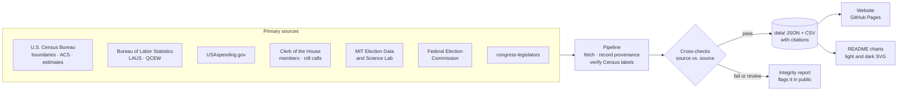

<div align="center">

<a href="{{site_url}}"></a>

<h1>WI-7 Atlas</h1>

<h3>{{tagline}}</h3>

<p>A public, nonpartisan atlas of Wisconsin's 7th Congressional District: who lives there, how they make a living,<br/>what federal money reaches it, and how the seat in Congress has been held and voted.<br/><b>Every number links to its primary source, and independent sources are checked against each other before anything ships.</b></p>

<p>
<a href="{{site_url}}"><picture><source media="(prefers-color-scheme: dark)" srcset="docs/media/buttons/open-dark.svg" /></picture></a>
&nbsp;
<a href="#-how-every-number-is-checked"><picture><source media="(prefers-color-scheme: dark)" srcset="docs/media/buttons/checks-dark.svg" /></picture></a>
&nbsp;
<a href="data/{{district_id}}/"><picture><source media="(prefers-color-scheme: dark)" srcset="docs/media/buttons/data-dark.svg" /></picture></a>
</p>

{{badges}}

{{glance}}

<sub>{{glance_note}}</sub>

[The district](#-the-district-in-one-picture) · [People](#-who-lives-here) · [Work](#-how-people-make-a-living) · [Federal dollars](#-federal-dollars) · [Representation](#-representation-and-elections) · [Counties](#-county-by-county) · [Checks](#-how-every-number-is-checked) · [Reuse it](#-reuse-it-for-another-district) · [Sources](#-sources)

</div>

---

## 🧭 What this is

<table>
<tr>
<td width="33%" valign="top">

### 📍 One district, in full
Twenty-six counties from Lake Superior to central Wisconsin, mapped to the boundaries the U.S. House uses today, with the five split counties drawn as they really are.

</td>
<td width="33%" valign="top">

### 🧾 Every number has a receipt
Each figure carries its publisher, the exact query, the data vintage, and the day it was retrieved. Sources are cited in APA style on the site and below.

</td>
<td width="33%" valign="top">

### 🔁 Refreshed and re-checked
A scheduled GitHub Action rebuilds the data each week, runs {{check_count}} cross-checks between independent sources, and redraws every chart in this README.

</td>
</tr>
</table>

{{video_block}}

{{gallery}}

## 🗺 The district in one picture

<p align="center"><picture><source media="(prefers-color-scheme: dark)" srcset="docs/media/charts/map-dark.svg" /></picture></p>

{{map_text}}

<p align="center"><picture><source media="(prefers-color-scheme: dark)" srcset="docs/media/charts/population-dark.svg" /></picture></p>

## 👥 Who lives here

{{people_text}}

<p align="center"><picture><source media="(prefers-color-scheme: dark)" srcset="docs/media/charts/compare-dark.svg" /></picture></p>

<p align="center"><picture><source media="(prefers-color-scheme: dark)" srcset="docs/media/charts/age-dark.svg" /></picture></p>

## 💼 How people make a living

{{work_text}}

<p align="center"><picture><source media="(prefers-color-scheme: dark)" srcset="docs/media/charts/industry-dark.svg" /></picture></p>

<p align="center"><picture><source media="(prefers-color-scheme: dark)" srcset="docs/media/charts/unemployment-dark.svg" /></picture></p>

## 🏛 Federal dollars

{{federal_text}}

<p align="center"><picture><source media="(prefers-color-scheme: dark)" srcset="docs/media/charts/federal-dark.svg" /></picture></p>

{{agencies_table}}

## 🗳 Representation and elections

{{representation_text}}

<p align="center"><picture><source media="(prefers-color-scheme: dark)" srcset="docs/media/charts/seat-dark.svg" /></picture></p>

{{notes_block}}

<p align="center"><picture><source media="(prefers-color-scheme: dark)" srcset="docs/media/charts/elections-dark.svg" /></picture></p>

{{votes_block}}

{{fec_block}}

## 🏘 County by county

{{county_table}}

## ✅ How every number is checked



Three rules keep the atlas honest:

1. **Two sources or a recorded fact, every time it matters.** The county list is checked against the recorded 26 counties; the 2020 population must agree three ways; the sitting member must be the same in the volunteer-maintained record and in the Clerk's; the most recent election winner must be the member who took office after it.
2. **A label check before any Census number is used.** Every Census variable's official label is compared with what the atlas says it means. If a table is renumbered, that measure is dropped and the check fails in public.
3. **Nothing unofficial without a label and a review date.** Hand-written notes (like a race called by news organizations before certification) carry sources, a verification date, and a review-by date; an overdue note turns the check yellow.

{{integrity_table}}

<details>
<summary><b>What a receipt looks like</b></summary>

Every data file wraps its numbers with the sources used to make them:

```json
{{receipt_example}}
```

</details>

## ♻️ Reuse it for another district

The whole atlas is driven by one small file. Copy [`config/districts/wi-07.yaml`](config/districts/wi-07.yaml), change the identifiers, and build:

```yaml
id: mn-08
name: Minnesota's 8th Congressional District
short_name: MN-8
state: { name: Minnesota, abbr: MN, fips: "27" }
district: "08"
district_number: 8
congress: 119
```

```bash
python -m pipeline all --district mn-08
```

The pipeline, the checks, the charts, and the website read everything district-specific from that file.

## 🛠 Run it yourself

```bash
git clone https://github.com/{{repo}}.git && cd {{repo_name}}
pip install -r requirements.txt && npm install  # Python pipeline, mapshaper for the map
python -m pipeline all                           # fetch, check, chart, and write README.md
python -m http.server -d site 8000               # then open http://localhost:8000
python -m pytest                                 # unit tests and site checks
```

Optional free API keys raise rate limits: `CENSUS_API_KEY`, `BLS_API_KEY`, `FEC_API_KEY` (from api.data.gov). Without them the pipeline uses the public limits.

<details>
<summary><b>Repository layout</b></summary>

```
config/districts/      one YAML file per district
pipeline/              Python: sources/, checks.py, charts.py, readme.py
data/<district>/       JSON outputs with citations, plus geo/ TopoJSON
data/curated/          hand-written notes, each with sources and a review date
site/                  the website (plain HTML, CSS, and ES modules; no build step)
tools/                 screenshots, video, and GIF rendering
tests/                 pytest unit tests and Playwright site checks
.github/workflows/     tests, weekly data refresh, Pages deploy, media
```

</details>

## 🤝 Principles

- **Nonpartisan.** The atlas follows the seat, not any officeholder or party. It describes votes, money, and public data, not personalities. Party colors appear only on election charts.
- **Primary sources.** Census Bureau, Bureau of Labor Statistics, USAspending.gov, the Clerk of the House, the Federal Election Commission, and the MIT Election Data and Science Lab, which compiles official state results.
- **Labels over guesses.** Unofficial results are labeled until certified, estimates carry their margins of error, and split counties are never counted as whole.
- **Open by default.** Code, data, and the method are public. Corrections are welcome as GitHub issues.

## 📚 Sources

{{sources_list}}

## ℹ️ About

Published by **{{publisher}}** as an independent civic resource. Not affiliated with any candidate, party, campaign, or government office. Companion site: [widistrict7.com](https://widistrict7.com/).

Design inspired by the [Global Intelligence Atlas](https://github.com/Normansrule/global-intelligence-atlas). Built with plain HTML, CSS, and JavaScript, [D3](https://d3js.org/), and [mapshaper](https://github.com/mbloch/mapshaper).

Code: MIT License. Text and charts: CC BY 4.0. Federal data are in the public domain; see each source's terms.

<sub>README generated {{built_date}} from the data in this repository by <code>python -m pipeline readme</code>. Do not edit README.md by hand; edit <code>docs/README.template.md</code>.</sub>
